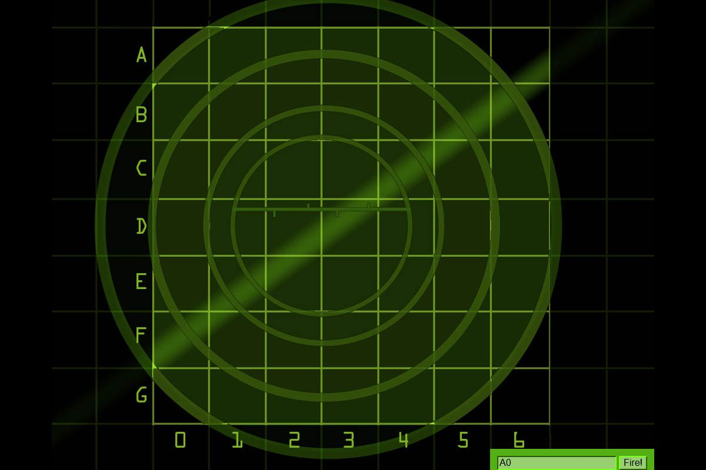

# ⚓ Морской бой

**Браузерная игра на поле 7 × 7. Расстановка кораблей меняется с каждой новой партией.**

  

[Открыть игру](https://goldlexx.github.io/battleship/)

Введите координату от `A0` до `G6` и нажмите **Fire!**. Попадания и промахи отмечаются на радаре. Когда все палубы корабля найдены, игра сообщает о потоплении. Повторный выстрел в уже проверенную клетку не засчитывается как новое попадание.

## Локальный запуск

Откройте `index.html` из корня репозитория в браузере.

## Проверка

`node --test` запускает проверки расстановки кораблей и повторных выстрелов.
